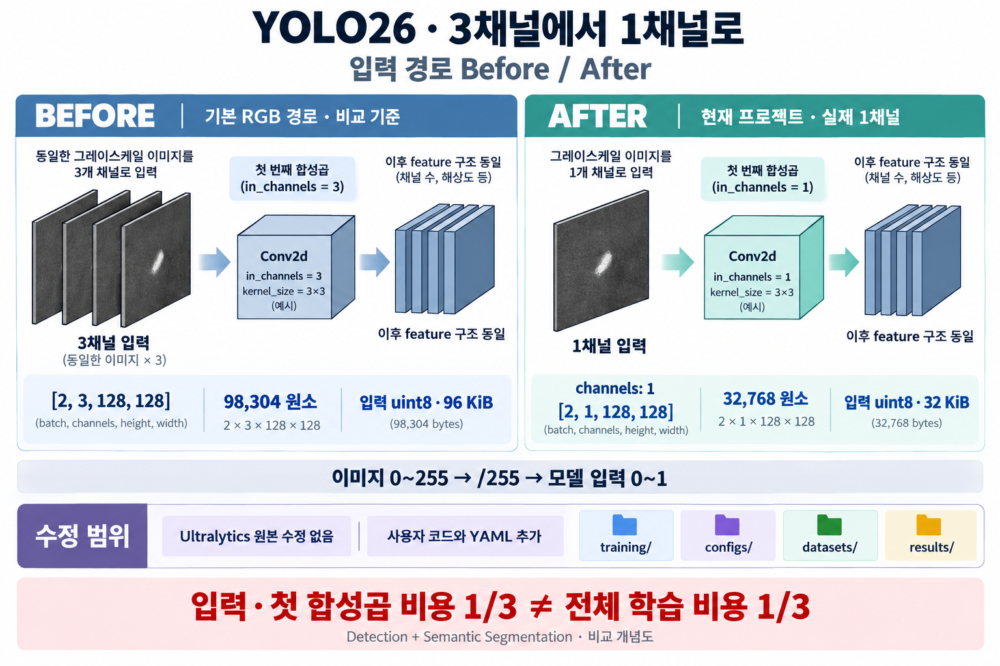
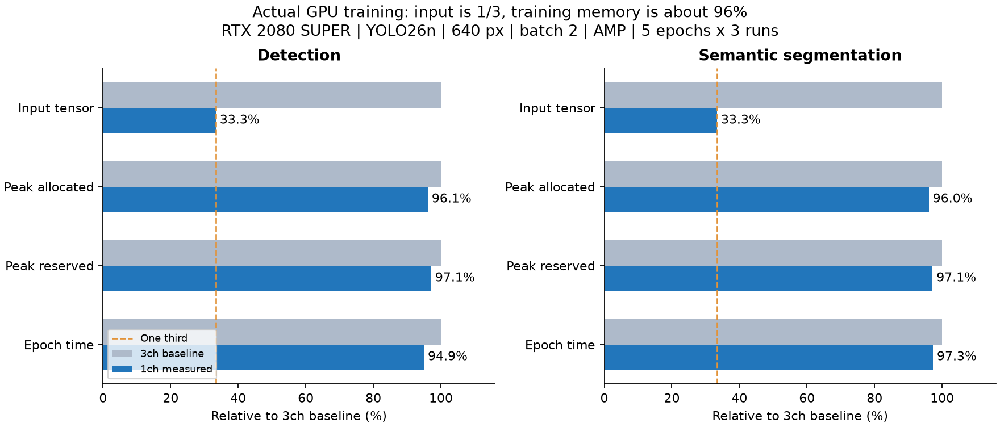

# YOLO26 그레이스케일 GPU 작업 환경

Detection과 **semantic segmentation(픽셀 클래스 mask)** 을 모두 실제 1채널로 학습합니다.
Python 3.11.13 / torch 2.11.0+cu130 / torchvision 0.26.0+cu130 / Ultralytics 8.4.168을 사용합니다.
Ultralytics는 공식 저장소를 복제한 뒤 안정 태그 `v8.4.168`, 커밋 `695612529`의 작업 트리를 editable로 설치합니다.

## Before / After: 무엇이 달라졌는가



**Ultralytics 원본 Python 소스를 수정한 것은 아닙니다.** 기존의 1채널 데이터 로더·모델 구성 기능을 사용하고,
이 프로젝트에 사용자 실행 코드, YAML, 입력 검증과 결과 저장 기능을 추가했습니다.
작업 시작 시 로컬 프로젝트는 의존성이 비어 있는 `pyproject.toml`만 있는 상태였습니다.
따라서 이미지의 Before는 과거에 실행한 프로젝트나 성능 측정 결과가 아니라 **기본 RGB 입력 경로를 비교 기준으로 그린 개념도**입니다.
After의 `[2,1,128,128]`은 실제 GPU 예제 학습에서 확인한 batch 형상입니다.

### 파일별 변경 내용

| 변경 위치 | Before / 비교 기준 | After / 현재 구현 |
|---|---|---|
| [pyproject.toml](pyproject.toml), [.python-version](.python-version), [setup.ps1](setup.ps1) | 로컬 프로젝트 의존성 목록이 비어 있고 전용 설치 도구가 없음 | Python·CUDA용 torch/torchvision 고정, 로컬 Ultralytics editable 설치, 선택적 TensorRT 설치와 GPU 확인 |
| [데이터 YAML](configs/datasets/detection.yaml), [semantic 데이터 YAML](configs/datasets/semantic.yaml) | 입력 channels를 생략하면 기본 3채널 사용 | 두 작업 모두 `channels: 1`; 실제 데이터 경로와 클래스 이름을 YAML로 분리 |
| [모델 YAML](configs/models/yolo26n-gray.yaml), [semantic 모델 YAML](configs/models/yolo26n-gray-sem.yaml) | 공식 모델 구조 YAML을 라이브러리 내부에서 사용 | 구조를 사용자 설정 폴더에 보관하고 nano scale을 명시; 실제 모델 입력 채널은 trainer의 데이터 설정으로 결정 |
| [training/train.py](training/train.py) | 별도의 사용자 학습 코드가 없음; `YOLO(model_yaml)`로 모델을 먼저 만들면 기본 3채널로 초기화 | native trainer가 처음부터 `ch=data['channels']`로 모델을 생성; 학습 전 실제 batch와 첫 합성곱 채널을 검사하고 `channel_audit.json` 저장 |
| [tools/common.py](tools/common.py), [tools/prepare_dataset.py](tools/prepare_dataset.py) | 사용자 이미지 형상·값 범위·mask 규칙을 사전에 검사하는 코드가 없음 | 단일 채널과 `0..255` 확인, 16비트 컨테이너의 유효 8비트 값을 보존해 PNG 준비, semantic mask 크기·클래스 ID 검사 |
| [training/train.py의 transfer_rgb_stem](training/train.py) | RGB checkpoint를 1채널 모델로 기본 전이할 때 첫 합성곱의 입력 채널 커널을 부분 복사 | 선택적으로 RGB pretrained를 쓸 때 `W_gray = W_R + W_G + W_B`로 전이; 학습 모델과 EMA 모델에 함께 반영 |
| [inference/predict.py](inference/predict.py), [inference/evaluate.py](inference/evaluate.py) | 프로젝트 전용 추론·평가 실행 코드와 저장 경로가 없음 | detection JSON·overlay, semantic 클래스-ID mask·overlay, mAP/mIoU 평가 지표를 지정된 결과 폴더에 저장 |
| [exporting/export.py](exporting/export.py) | 프로젝트 전용 모델 변환 코드가 없음 | ONNX/TensorRT 변환, ONNX 입력 채널 검사, `/255` 전처리 규칙을 manifest에 기록 |
| [datasets/README.md](datasets/README.md), [results/README.md](results/README.md) | 실제 데이터와 학습 결과를 보관할 구분된 폴더가 없음 | 실제 데이터·합성 예제·학습·예측·평가·변환 결과를 각각 분리 |

### 1채널을 적용한 핵심 설정과 실행 경로

Before는 기본 설정의 예시입니다. `channels`를 생략하면 native 데이터 확인 단계에서 3으로 처리합니다.

```yaml
# Before: 기본 RGB 입력을 사용하는 비교 설정
path: /path/to/dataset
train: images/train
val: images/val
names:
  0: target
```

```yaml
# After: configs/datasets/detection.yaml의 핵심 설정
path: ../../datasets/detection
train: images/train
val: images/val
channels: 1
names:
  0: target
```

`channels: 1`을 모델 YAML에 적는 것만으로 `YOLO(yaml)`의 최초 생성이 항상 1채널이 되는 것은 아닙니다.
사용자 학습 코드는 **데이터 YAML을 읽은 native trainer를 통해 모델을 처음부터 생성**합니다.

```python
# training/train.py: 작업별 native trainer 선택
trainer_class = DetectionTrainer if task == "detect" else SemanticSegmentationTrainer
trainer = trainer_class(overrides=config)
trainer.add_callback("on_train_start", audit_input)
trainer.train()

# 원본 trainer가 이미 제공하는 모델 구성 방식 (기존 기능, 원본 수정 없음):
# DetectionModel(..., ch=self.data["channels"])
# SemanticSegmentationModel(..., ch=self.data["channels"])
```

이미지는 원본의 전처리 경로에서 `/255`를 거쳐 `0..1`이 됩니다. 이 계산은 3채널/1채널 모두 동일하며,
변경점은 같은 grayscale 이미지의 RGB 3채널 표현을 학습에 쓰는 대신 실제 1채널 텐서를 쓰는 것입니다.
Semantic mask의 값은 픽셀 클래스 ID이므로 이미지 정규화를 적용하지 않습니다.

### 이미지의 수치와 절감 범위

동일한 batch 2, 해상도 128×128, 입력 dtype uint8을 기준으로 계산했습니다.

| 항목 | RGB 비교 기준 | 실제 1채널 예제 |
|---|---:|---:|
| batch 형상 | `[2,3,128,128]` | `[2,1,128,128]` |
| 입력 원소 수 | 98,304 | 32,768 |
| uint8 입력 크기 | 96 KiB | 32 KiB |
| 첫 합성곱 입력 채널 | 3 | 1 |

이 수치는 **원시 입력 batch**만 설명하며 전체 GPU 메모리 측정값이 아닙니다. float32로 정규화한 같은 batch는
각각 384 KiB와 128 KiB이며 여전히 3:1입니다. 같은 첫 합성곱 출력 채널·커널·해상도라면 MACs도 3:1입니다.
이후 feature 구조, 대부분의 activation, 모델 파라미터와 연산은 유지되므로 전체 학습 비용 1/3을 뜻하지 않습니다.
원본 이미지가 8비트 grayscale 파일이면 디스크의 해당 이미지 파일 자체를 다시 1/3로 줄였다는 의미도 아닙니다.

실제 After 확인값은 [Detection 채널 보고서](results/training/detect/smoke/channel_audit.json)와
[Semantic 채널 보고서](results/training/semantic/smoke/channel_audit.json)에 있으며, 전체 검증 범위는
[VALIDATION.md](VALIDATION.md)에 기록했습니다. 그림은 이미지 생성 도구로 만든 설명용 개념도입니다.
[이미지 생성 프롬프트](docs/images/before-after-prompt.txt)도 함께 보관했습니다.

## 폴더

| 폴더 | 역할 |
|---|---|
| `training/` | 사용자 학습 실행 코드 |
| `configs/models/` | 1채널 detection / semantic 모델 구조 YAML |
| `configs/training/` | epochs, batch, GPU 등 학습 설정 YAML |
| `configs/datasets/` | 데이터 경로, 클래스 이름, `channels: 1` YAML |
| `datasets/` | 실제 이미지와 detection labels / semantic masks |
| `results/training/` | 가중치, loss/metric CSV, 그래프, 채널 검증 보고서 |
| `inference/` | 추론 결과 및 평가 코드 |
| `results/predictions/`, `results/evaluations/` | JSON, 시각화, 예측 mask, 평가 지표 |
| `exporting/`, `results/exports/` | 모델 변환 코드와 ONNX / TensorRT 파일 |
| `tools/` | 환경 확인, 예제 생성, 데이터 준비 도구 |
| `weights/` | 선택적으로 다운로드한 pretrained 가중치 |
| `vendor/ultralytics/` | 향후 수정할 수 있는 Ultralytics feature branch 작업 트리 |
| `ultralytics-src/` | 원본 복제 저장소와 Git 이력 |

## 설치 및 GPU 확인

PowerShell에서 프로젝트 루트 기준으로 실행합니다. 가상환경 activate 없이 `uv run`을 사용합니다.

```powershell
cd C:\Git\ym_yolo
.\setup.ps1
# TensorRT까지 설치할 경우:
.\setup.ps1 -TensorRT
uv run --no-sync python -m tools.check_environment
```

`--no-sync`는 설치한 optional TensorRT 패키지를 일반 실행에서 제거하지 않도록 합니다.
환경을 재구성할 때에는 `uv sync --locked --extra tensorrt`를 사용합니다.
TensorRT는 Turing GPU를 지원하는 10.13.3.9.post1/cu13로 고정했습니다. torch의 cu130과 별도 패키지입니다.
TensorRT 11 계열로 무조건 업그레이드하지 마세요. ONNX Runtime은 이 예제에서 CPU 실행용입니다.

## 입력 계약

- 이미지: 단일 평면 grayscale, uint8, 실제 값 `0..255`. 모델 입력은 `[B,1,H,W]`, float `/255`, `0..1`입니다.
- 16비트 PNG/TIFF 컨테이너에 값이 `0..255`만 있는 경우 아래 준비 도구로 uint8 PNG로 옮길 수 있습니다.
  픽셀 값은 동일하며 반올림, min-max 정규화, 65535 나눗셈을 하지 않습니다.
- 255를 넘는 이미지, RGB 이미지, multi-page TIFF는 자동으로 변환하지 않고 오류를 표시합니다.
- detection: YOLO txt (`class cx cy width height`, 좌표 `0..1`). 배경 이미지는 빈 txt 파일을 둡니다.
- semantic: 이미지와 동일한 크기의 PNG mask, 값은 클래스 ID입니다. 예제는 `0=background, 1=target, 255=ignore`입니다.
  배경도 `names`에 포함하는 multi-class 방식으로 시작합니다. mask에는 `/255`를 적용하지 않습니다.
- `0/255` 이진 mask에서 255가 foreground라면 데이터 YAML에 `label_mapping: {0: 0, 255: 1}`를 명시합니다.
  기본 255=ignore와 의미가 다르므로 임의 추정하지 않습니다. 팔레트 PNG는 색이 아닌 palette index를 사용합니다.
- 데이터 YAML의 `path`는 **YAML 파일 위치 기준**, train/val/test는 데이터 root 기준입니다.
  예제 실행 도구는 폴더 split을 지원합니다. 이미지 목록 txt, 영상 및 스트림은 범위에 포함하지 않습니다.

**실제 데이터 저장 위치를 이미 생성했습니다.** 다음 폴더에 파일을 넣으면 기본 학습 YAML이 사용합니다.

| 데이터 | 절대 경로 |
|---|---|
| Detection 학습 이미지 / 라벨 | `C:\Git\ym_yolo\datasets\detection\images\train\` / `C:\Git\ym_yolo\datasets\detection\labels\train\` |
| Detection 검증 이미지 / 라벨 | `C:\Git\ym_yolo\datasets\detection\images\val\` / `C:\Git\ym_yolo\datasets\detection\labels\val\` |
| Semantic 학습 이미지 / mask | `C:\Git\ym_yolo\datasets\segmentation\images\train\` / `C:\Git\ym_yolo\datasets\segmentation\masks\train\` |
| Semantic 검증 이미지 / mask | `C:\Git\ym_yolo\datasets\segmentation\images\val\` / `C:\Git\ym_yolo\datasets\segmentation\masks\val\` |

클래스가 정해지면 `configs/datasets/detection.yaml`, `configs/datasets/semantic.yaml`의 `names`와
semantic `label_mapping`을 수정하세요. 현재 클래스 이름은 자리 표시자입니다.

```text
datasets/my_detect/
  images/train/a.png      labels/train/a.txt
  images/val/b.png        labels/val/b.txt
datasets/my_semantic/
  images/train/a.png      masks/train/a.png
  images/val/b.png        masks/val/b.png
```

16비트 컨테이너를 준비할 때에는 출력용 새 디렉토리를 지정합니다. 원본을 덮어쓰지 않습니다.

```powershell
uv run --no-sync python -m tools.prepare_dataset --source C:\Data\raw_detect --output datasets/my_detect --task detect
uv run --no-sync python -m tools.prepare_dataset --source C:\Data\raw_semantic --output datasets/my_semantic --task semantic
```

## 예제 학습

합성 사각형 데이터는 전체 실행 경로 확인용이며 사용자 실데이터의 정확도나 리소스 절감 비율을 대표하지 않습니다.

```powershell
uv run --no-sync python -m tools.make_example_dataset
uv run --no-sync python -m training.train --config configs/training/detect.yaml --data configs/datasets/example_detect.yaml --epochs 1 --imgsz 128 --name smoke
uv run --no-sync python -m training.train --config configs/training/semantic.yaml --data configs/datasets/example_semantic.yaml --epochs 1 --imgsz 128 --name smoke
```

기본 학습은 nano 모델, GPU 0, batch 2, workers 0, AMP이며 RGB 색 증강은 꺼져 있습니다.
실제 데이터는 위의 미리 만든 폴더에 넣고 데이터 YAML의 names/label_mapping을 맞춥니다.
다음 명령은 기본 실제 데이터 폴더로 YAML의 50 epochs / 640px 설정을 사용합니다.

```powershell
uv run --no-sync python -m training.train --config configs/training/detect.yaml
uv run --no-sync python -m training.train --config configs/training/semantic.yaml
```

다른 데이터 YAML을 사용하려면 `--data`로 덮어쓸 수 있습니다.
결과 디렉토리가 이미 있으면 Ultralytics가 `smoke2` 등 새 이름을 만듭니다. 출력 로그의 최종 경로를 사용하세요.
얇은 결함의 semantic mask는 작은 imgsz에서 정보가 사라질 수 있으므로 실데이터 해상도에서 검증해야 합니다.

```powershell
# 정상적으로 종료하지 못한 학습을 last.pt에서 재개:
uv run --no-sync python -m training.train --config configs/training/detect.yaml --resume results/training/detect/smoke/weights/last.pt
```

`resume`은 저장된 epochs/imgsz/name을 사용합니다. 이미 완료된 학습의 추가 fine-tuning은 새 run으로 시작합니다.
pretrained 없이 시작하도록 기본 설정했습니다. pretrained를 원하면 `weights/`에 pt를 저장하고 학습 YAML의
`weights` 주석을 해제합니다. RGB 첫 convolution은 3개의 채널 커널을 합산해 grayscale 응답을 보존합니다.
그 뒤 나머지 학습은 1채널입니다. 데이터셋과 클래스 수에 맞는 실제 fine-tuning 평가는 별도로 필요합니다.

## 추론 및 정답 평가

```powershell
uv run --no-sync python -m inference.predict --task detect --model results/training/detect/smoke/weights/best.pt --source datasets/example_detect/images/val --imgsz 128
uv run --no-sync python -m inference.predict --task semantic --model results/training/semantic/smoke/weights/best.pt --source datasets/example_semantic/images/val --imgsz 128
uv run --no-sync python -m inference.evaluate --task detect --model results/training/detect/smoke/weights/best.pt --data configs/datasets/example_detect.yaml --imgsz 128
uv run --no-sync python -m inference.evaluate --task semantic --model results/training/semantic/smoke/weights/best.pt --data configs/datasets/example_semantic.yaml --imgsz 128
```

추론은 overlay와 JSON을 저장합니다. Detection JSON은 class/confidence/xyxy, semantic 결과는 원본 크기의
클래스-ID `.mask.png`와 클래스별 픽셀 수입니다. overlay는 사람이 보는 그림이며 학습 라벨로 사용하면 안 됩니다.
평가는 detection mAP / semantic mIoU와 pixel accuracy를 `metrics.json`에 저장합니다.

## ONNX / TensorRT 변환과 재사용

```powershell
uv run --no-sync python -m exporting.export --model results/training/detect/smoke/weights/best.pt --format onnx --imgsz 128
uv run --no-sync python -m exporting.export --model results/training/semantic/smoke/weights/best.pt --format onnx --imgsz 128
uv run --no-sync python -m exporting.export --model results/training/detect/smoke/weights/best.pt --format engine --fp16 --imgsz 128
uv run --no-sync python -m exporting.export --model results/training/semantic/smoke/weights/best.pt --format engine --fp16 --imgsz 128
```

TensorRT 명령 전 `.\setup.ps1 -TensorRT`가 필요합니다. 기본은 batch 1 / 고정 해상도, ONNX FP32,
TensorRT FP16(옵션)입니다. `--dynamic`으로 동적 크기를 요청할 수 있지만 최초 확인은 고정 크기로 권장합니다.
TensorRT 엔진은 대상 GPU·Windows/Linux·TensorRT 버전에 맞춰 다시 빌드합니다.
배포 입력도 반드시 단일 채널 `/255`, ONNX/engine 입력 형상 `[B,1,H,W]`를 유지합니다.

```powershell
uv run --no-sync python -m inference.predict --task detect --model results/exports/detect/smoke/best.onnx --source datasets/example_detect/images/val --device cpu --imgsz 128
uv run --no-sync python -m inference.predict --task semantic --model results/exports/semantic/smoke/best.engine --source datasets/example_semantic/images/val --imgsz 128
```

## 절감 범위와 원본 소스 위치

동일 예제 이미지셋으로 **실제 GPU 학습 비교**를 실행했습니다. RTX 2080 SUPER, YOLO26n,
640px, batch 2, AMP, 각각 5 epochs × 3회에서 1ch의 최대 텐서 메모리는 detection **3.92%**,
semantic **3.98%** 줄었습니다. 캐시 포함 예약 메모리는 약 **2.9%** 감소했습니다.
입력 텐서는 정확히 1/3이지만 전체 학습 VRAM이 1/3이 되지는 않았습니다.
현재 사용자 코드는 RGB 파일을 자동으로 1ch로 변환하지 않고 입력 검증에서 거부합니다.



실험 조건, 손실/평가 차이, 측정 한계, 반복별 CSV는 [실제 비교 보고서](docs/channel-benchmark-20261001.md)에 있습니다.

```powershell
# 같은 예제 픽셀을 1ch / 3ch PNG로 준비하고 독립 프로세스에서 학습 비교:
uv run --no-sync python -m tools.benchmark_channels --epochs 5 --repeats 3 --imgsz 640 --batch 2

# 실제 데이터를 저장한 다음 재측정:
uv run --no-sync python -m tools.benchmark_channels --detect-data configs/datasets/detection.yaml --semantic-data configs/datasets/semantic.yaml
```

결과는 `results/benchmarks/<실행시각>/`의 `summary.json`과 실행별 `measurement.json`에 저장합니다.

`3→1채널`은 같은 dtype/해상도/batch의 **입력 텐서 원소·메모리와 첫 convolution MACs**를 1/3로 만듭니다.
뒤의 feature channel 수, 대부분의 모델 파라미터/activation/연산은 동일하므로 전체 학습 리소스 1/3을 보장하지 않습니다.
매 학습 run의 `channel_audit.json`은 실제 batch `[B,1,H,W]`와 첫 convolution `in_channels=1`을 기록합니다.
전체 리소스를 1/3에 가깝게 줄이는 별도 목표에는 nano 모델, 해상도/폭/깊이 조정과 정확도 비교가 필요합니다.

현재는 원본 소스를 수정하지 않고 기존 기능을 사용합니다. 이후 수정할 경우 `vendor/ultralytics/`에서 진행합니다.

| 원본 영역 | 역할 |
|---|---|
| `ultralytics/data/base.py`, `data/loaders.py` | `channels: 1` grayscale 읽기 |
| `ultralytics/models/yolo/detect/train.py` | 데이터 channels로 detection 모델 구성, `/255` |
| `ultralytics/models/yolo/semantic/train.py`, `data/dataset.py` | 1채널 semantic 모델, 클래스-ID mask 읽기 |
| `ultralytics/nn/tasks.py` | 모델 입력 채널과 pretrained weight 처리 |
| `ultralytics/engine/predictor.py`, `engine/exporter.py` | 1채널 추론 전처리·내보내기 입력과 metadata |

원본 AGPL-3.0 라이선스는 복제 저장소의 LICENSE에 포함되어 있습니다.
`uv.lock`은 환경만 고정하므로 이후 Ultralytics 소스 변경도 해당 Git 작업 트리에 별도로 보관해야 합니다.

## 검증

```powershell
uv run --no-sync pytest tests -q
uv run --no-sync ruff check tools training inference exporting tests
```

이 세션의 실제 검증 결과와 제한은 `VALIDATION.md`에 기록합니다.
